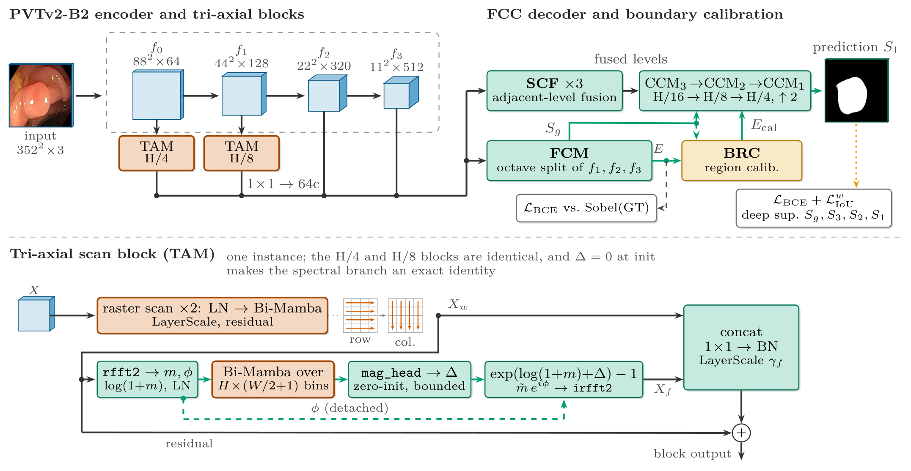
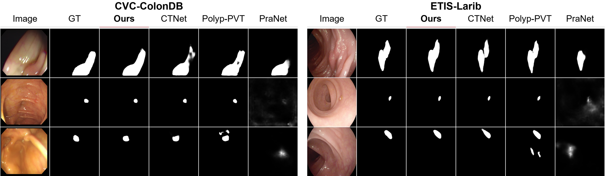
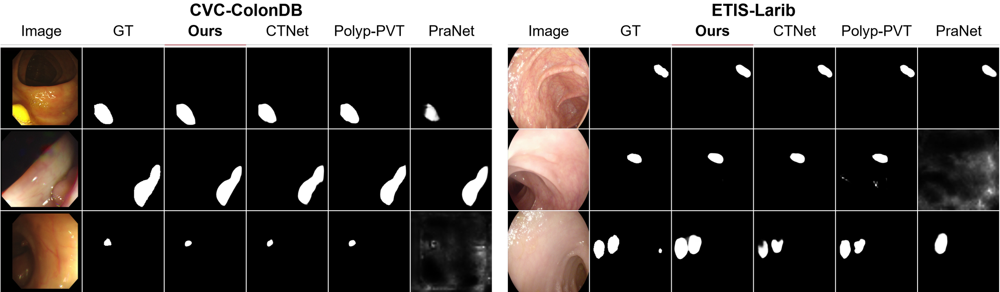
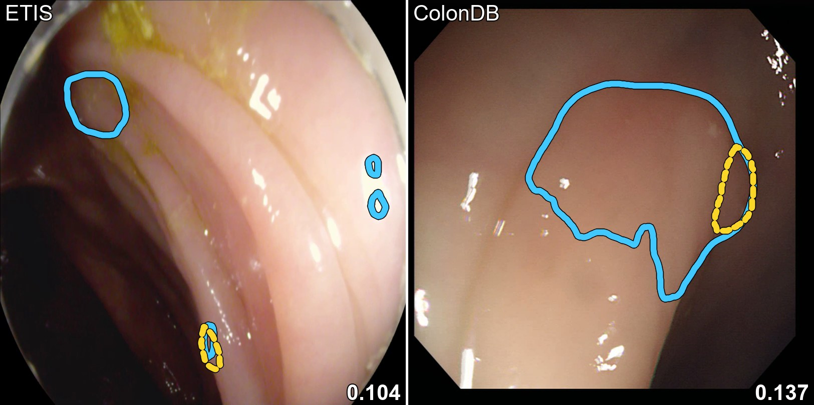
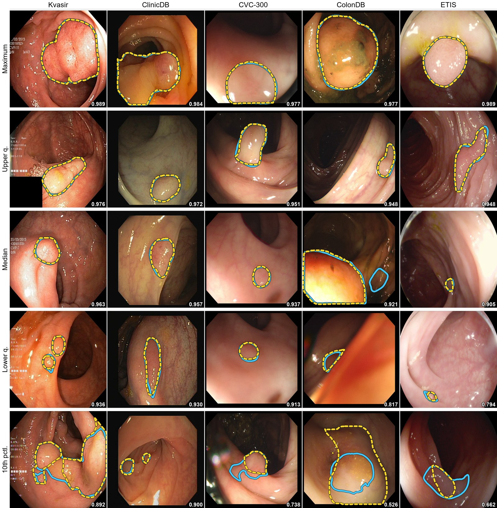
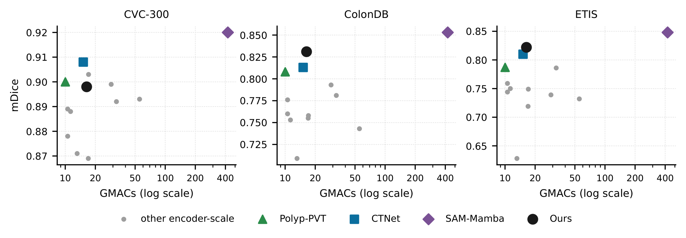
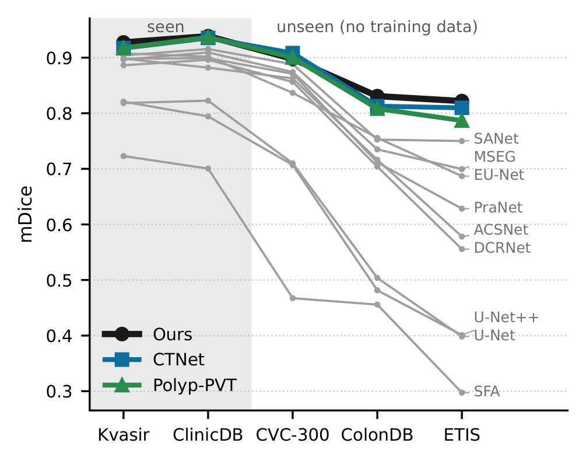

<div align="center">

# SpectraMambaNet

### Tri-Axial State-Space Polyp Segmentation with Zero-Initialized Boundary Calibration

**WACV 2027 &nbsp;·&nbsp; Applications Track**

[](https://wacv.thecvf.com/Conferences/2027)
[](https://github.com/darskkaa/SpectraMambaNet/actions/workflows/verify.yml)
[](LICENSE)
[](https://www.python.org/)
[](https://pytorch.org/)
[](https://lightning.ai/)

[](#cost)
[](#cost)
[](#cost)
[](#verify-without-a-gpu)
[](#pretrained-weights)

[Results](#results) · [Weights](#pretrained-weights) · [Evaluate](#evaluate-the-shipped-weights) · [Verify](#verify-without-a-gpu) · [Reproduce](#reproduce-the-run) · [Model card](MODEL_CARD.md) · [Citation](#citation)

</div>

<p align="center">
  
</p>
<p align="center"><sub>A PVTv2-B2 encoder feeds two tri-axial state-space blocks (TAM), each running a height scan, a width scan and a scan over the rFFT half-spectrum bins. A frequency-decoupled octave-convolution decoder (FCM, SCF, CCM) emits the guide, the prediction cascade and an edge logit, which the zero-initialized calibration head (BRC) corrects inside a band around the guide's contour.</sub></p>

Code, configuration, weights, prediction maps, per-image scores and the training logs for
*Tri-Axial State-Space Polyp Segmentation with Zero-Initialized Boundary Calibration*
(WACV 2027, Applications Track). One 160-epoch run on a single NVIDIA L4 produced the shipped
model, and `scripts/verify_release.py` re-derives every headline number from the files in
this repository, with no GPU required.

The weights are for research only. They are not a medical device, have not been clinically
validated, and must not be used to diagnose or treat patients. [MODEL_CARD.md](MODEL_CARD.md)
sets out their intended use, training data and known limits.

## News

- **Oct 2026** Accepted to WACV 2027, Applications Track.
- **Oct 2026** Code, weights, all 798 prediction maps, per-image scores and both training logs are in this repository.

## Highlights

- Best encoder-scale mean Dice on Kvasir-SEG (0.927) and on the two largest unseen centres,
  CVC-ColonDB (0.831) and ETIS-Larib (0.822), at 34.85 M parameters and 26.4 FPS on one L4.
- Up to +0.194 Dice over the split-defining PraNet baseline on the unseen centres. Against the
  released maps of eleven methods, paired per-image tests find the lead significant on all
  five datasets for eight of them.
- The spectral scan axis matches a parameter-matched raster control within run-to-run
  resolution while scanning a sequence about half as long.
- Everything behind the numbers ships here: weights, prediction maps, per-image scores, both
  console logs, and a script that runs 129 checks against those files without a GPU.

---

## The model in one paragraph

A PVTv2-B2 encoder feeds two **tri-axial state-space blocks** at the 1/8 and 1/4 scales:
alongside the two spatial scan axes, a third axis scans the rFFT **half**-spectrum, which is
Hermitian-complete at 1.9× fewer tokens than a full-spectrum scan. An octave-convolution
decoder (ported from FCC-Net's released code and modified) fuses the scales, and a
**zero-initialized boundary calibration head** applies a logit-space correction that starts
as an exact identity, so it cannot destabilize the base model it corrects. The paper's
ablation attributes its largest step to a stage that adds no parameters and no compute, and a
parameter-matched raster-scan control isolates what the spectral axis does and does not buy.

---

## Results

### Against the published field: mean Dice, PraNet split

Kvasir-SEG and CVC-ClinicDB supply the training data; **CVC-300, CVC-ColonDB and
ETIS-Larib are unseen centres** that contribute none. Competitor values are taken from
published tables. **Bold** is the best and *italic* the second-best value within the
encoder-scale group (≤ 45 M parameters); the foundation-scale group (≥ 100 M) is listed for
context only.

| Method | Venue | Kvasir-SEG | CVC-ClinicDB | CVC-300 † | CVC-ColonDB † | ETIS-Larib † |
|---|---|---|---|---|---|---|
| U-Net | MICCAI '15 | 0.818 | 0.823 | 0.710 | 0.512 | 0.398 |
| U-Net++ | DLMIA '18 | 0.821 | 0.794 | 0.707 | 0.483 | 0.401 |
| PraNet | MICCAI '20 | 0.898 | 0.899 | 0.871 | 0.709 | 0.628 |
| SANet | MICCAI '21 | 0.904 | 0.916 | 0.888 | 0.753 | 0.750 |
| MSNet | MICCAI '21 | 0.907 | 0.921 | 0.869 | 0.755 | 0.719 |
| HSNet | CBM '22 | *0.926* | 0.937 | 0.903 | 0.810 | 0.808 |
| PVT-Cascade | WACV '23 | 0.911 | 0.919 | 0.892 | 0.781 | 0.786 |
| CFA-Net | PR '23 | 0.915 | 0.933 | 0.893 | 0.743 | 0.732 |
| Polyp-PVT | CAAI AIR '23 | 0.917 | 0.937 | 0.900 | 0.808 | 0.787 |
| MEGANet | WACV '24 | 0.913 | 0.938 | 0.899 | 0.793 | 0.739 |
| EMCAD | CVPR '24 | 0.894 | *0.944* | 0.878 | 0.760 | 0.744 |
| IC-PolypSeg | ICASSP '24 | 0.910 | 0.938 | *0.907* | 0.799 | 0.758 |
| CTNet | TCYB '24 | 0.917 | 0.936 | **0.908** | *0.813* | *0.810* |
| M²SNet | MIR '26 | 0.912 | 0.922 | 0.903 | 0.758 | 0.749 |
| Polyp-DiFoM | WACV '26 | 0.909 | **0.958** | 0.889 | 0.776 | 0.759 |
| **Ours** | WACV '27 | **0.927** | 0.939 | 0.898 | **0.831** | **0.822** |
| *SAM-Mamba* | WACV '25 | 0.924 | 0.942 | 0.920 | 0.853 | 0.848 |
| *HAT-SAM3* | Vis. Comput. '26 | 0.929 | 0.896 | 0.929 | 0.849 | 0.815 |

† unseen centre &nbsp;·&nbsp; last two rows: foundation-scale (≥ 100 M parameters; SAM-Mamba is 103 M and 423 GMACs)

The model improves on the split-defining PraNet baseline by up to **+0.194 Dice** on the
unseen centres. On per-image significance (paired Wilcoxon on each method's released maps,
Holm-corrected), the lead is significant on **all five datasets against eight of the eleven**
released-map methods, and against **all eleven on Kvasir-SEG and CVC-ColonDB**. CVC-300 is
the one dataset where the lead does not hold, and the paper prints that. Method, sources and
the command that reproduces it: [Paired significance](#paired-significance).

### Qualitative comparison

<p align="center">
  
</p>
<p align="center"><sub>The two hardest unseen centres. Rows are drawn from frames where our per-image Dice leads every shown method, spread over our Dice range with the margin over the strongest entry capped at 0.12. Maps are unthresholded.</sub></p>

<details>
<summary>The same comparison sampled at the quartiles of the margin, rows a comparator wins included</summary>
<br>
<p align="center">
  
</p>
<p align="center"><sub>Rows sit at the quartiles of our per-image Dice margin over the strongest encoder-scale entry, so the grid reflects the distribution of that margin rather than its upper tail. Maps are unthresholded.</sub></p>
</details>

<table>
  <tr>
    <td width="55%"></td>
    <td>
      <b>Failure cases.</b> The two lowest per-image Dice frames above the 0.1 threshold
      over all five collections. The annotation is the dashed yellow contour, our prediction
      the solid cyan one, with its Dice in the corner. The quantile span follows below, and
      the frames under 0.1 are in the supplement's failure gallery.
    </td>
  </tr>
</table>

<details>
<summary>Overlays at five quantiles of per-image Dice on every collection</summary>
<br>
<p align="center">
  
</p>
<p align="center"><sub>Maximum, upper quartile, median, lower quartile and tenth percentile, top to bottom. Dashed yellow is the annotation, solid cyan the prediction, and each tile carries its Dice.</sub></p>
</details>

### This repository's own measurements

Weight-space soup of the epoch-80 and epoch-120 snapshots, evaluated at 352×352 under the
PraNet protocol. Boundary distance (HD95) and Recall are the two metrics a 2026 audit finds
missing from 25 of 27 polyp papers; every value below is recomputed from the prediction maps
in `predictions/`, thresholded at 0.5.

| dataset | mDice | mIoU | Recall@0.5 | HD95@0.5 | images |
|---|---|---|---|---|---|
| Kvasir *(in-domain)* | 0.9274 | 0.8838 | 0.9193 | 36.56 px | 100 |
| CVC-ClinicDB *(in-domain)* | 0.9386 | 0.8935 | 0.9584 | 6.81 px | 62 |
| CVC-300 *(unseen)* | 0.8980 | 0.8326 | 0.9589 | 13.37 px | 60 |
| CVC-ColonDB *(unseen)* | 0.8308 | 0.7531 | 0.8670 | 39.30 px | 380 |
| ETIS-LaribPolypDB *(unseen)* | 0.8219 | 0.7446 | 0.9202 | 102.95 px | 196 |

Mean over the five splits: **0.883335**. Per-image Dice for all 798 images is in
`results/fin2_soup8_scored.json`; the maps those scores were computed from are in
`predictions/`, so the table can be recomputed from this repository without a GPU.

### Cost

**34.85 M parameters, 16.37 GMACs** at 352×352 (thop, the field's reporting convention; the
profiler traces nothing inside the selective-scan kernel, so this is a lower bound, and the
paper says so), **26.4 FPS** at batch size 1 on one L4. Eight models measured on the same
harness: `results/efficiency.json`, convention notes in `results/COST.md`.

<p align="center">
  
</p>
<p align="center"><sub>Mean Dice against inference cost on the three centres that contribute no training data, with the cost axis logarithmic. Every value is transcribed from the paper's accuracy and cost tables, so only methods present in both carry a point, and our point uses the tabled 16.37 GMACs lower bound.</sub></p>

### Ablation

Each row adds one stage to the row above it. All four arms trained for 40 epochs at seed 0
and were scored at their last checkpoint with no weight averaging, so they sit below the
shipped model and only the rows compare with each other.

| stage | adds | params | GMACs | Kvasir | ClinicDB | CVC-300 | ColonDB | ETIS | mean |
|---|---|---|---|---|---|---|---|---|---|
| R0 | PVTv2-B2 encoder, plain U-shaped decoder | 31.47 M | 11.57 | .9053 | .9244 | .8926 | .8053 | .8056 | .8666 |
| R1 | octave decoder, tri-axial blocks at 1/8 and 1/4 | 34.77 M | 15.68 | .9150 | .9139 | .8896 | .7974 | .7996 | .8631 |
| R2 | calibration head, boundary-band Dice, pixel contrast, deep supervision | 34.85 M | 16.37 | .9159 | .9325 | .8872 | .7988 | .7896 | .8648 |
| R3 | endoscopy augmentation (`--aug endo --hat-prob 0.5`); the shipped configuration | 34.85 M | 16.37 | .9196 | .9226 | .8909 | .8126 | .8188 | .8729 |

Two runs of one configuration landed 0.0040 apart on the five-set mean, and that is the
resolution of this table. R3 ends 0.0063 above R0. Its last step, +0.0081, changes only the
training data, so it adds no parameters and no GMACs. The two middle steps (−0.0035 and
+0.0017) are smaller than the resolution and show the path taken, not what each component
is worth.

The third-axis control replaces the spectral scan with a second raster scan. Both arms
add the bounded spectral gain to R3 and count 34.8337 M parameters. The spectral arm (M5)
scored .9281 / .9314 / .8890 / .8195 / .7954 (mean .8727) and the raster arm (M3)
.9177 / .9223 / .8921 / .8210 / .8170 (mean .8740). The 0.0013 gap is inside the resolution.
Removing the blocks and spending their budget on decoder width instead (M0) gives
34.9306 M parameters, more than the shipped model; M0 was counted, never trained.

`logs/ablation_R0-R3.txt` is the sweep's full console output, and `verify_release.py`
re-derives every R0-R3 cell, step, mean and cost above from it. The M3 and M5 runs left no
console log, so their Dice values are as the paper prints them and only their parameter
counts are re-derived. `configs/ablation_commands.sh` trains, predicts, scores and profiles
any arm.

---

## Layout

```
MANIFEST.md                    exact commit, environment, command, weights, and the
                               arithmetic tying them together (read this first)
MODEL_CARD.md                  intended use, training data, metrics and limits of the weights
SECURITY.md                    why a checkpoint runs code when loaded, and how to report a problem
CITATION.cff                   citation metadata behind GitHub's "Cite this repository"
NOTICE                         third-party code, weights and data, with their licences or terms
.gitattributes                 LF line endings in git; shell scripts stay LF on checkout
.github/
  workflows/verify.yml         CI: downloads the weights and runs both verifiers on CPU
  dependabot.yml               monthly updates to the SHA-pinned workflow actions
  ISSUE_TEMPLATE/              the bug report form
assets/                        the README's figures, rendered from the paper's figure files
configs/
  fin2_run_config.json         the 51 resolved settings, parsed from the run's own printout
  fin2_train_command.sh        the launch command, verbatim
  ablation_commands.sh         the R0-R3, M5 and M3 ablation arms, end to end
logs/
  run_final_2.txt              the complete 8.42 h console log, 1114 lines
  ablation_R0-R3.txt           the complete 6.7 h console log of the cumulative ablation
predictions/                   798 prediction maps, five splits
results/
  fin2_soup8_scored.json       per-image and per-split scores for the shipped weights
  fin2_eval_trajectory.json    all 32 evaluation points across the run
  significance_fin2.json       paired Wilcoxon results against eleven published methods
  competitors/                 per-image scores of the eleven methods' released maps
  efficiency.json              parameters and MACs, eight models, one harness
  COST.md                      the MAC convention, and the stale measurement not shipped
src/                           model, training, evaluation, souping, profiling
scripts/
  verify_release.py            re-derives every claim in MANIFEST.md from these files
  verify_mamba_ref.py          checks the CPU fallback scan against the CUDA kernel
docs/
  PROVENANCE.md                every number in the 2026-08-13 draft, the file it came from,
                               and what the final paper changed
  NUMBER_AUDIT.md              an independent check of PROVENANCE.md: 334 printed values
                               re-derived, 0 mismatches
  RUN_ANALYSIS.md              what the log shows about how the run behaved
```

Weights are **not** in git, since 140 MB is over the blob limit. See
[Pretrained weights](#pretrained-weights) below.

---

## Pretrained weights

| file | size | SHA-256 |
|---|---|---|
| [`fin2_soup8.ckpt`](https://github.com/darskkaa/SpectraMambaNet/releases/download/fin2-weights/fin2_soup8.ckpt) | 140,669,680 bytes | `598de21496dbc7f7c0619ea0d2401c7dc28b6d5885c638359d695e0c69401e0b` |

```bash
curl -LO https://github.com/darskkaa/SpectraMambaNet/releases/download/fin2-weights/fin2_soup8.ckpt
sha256sum fin2_soup8.ckpt
```

Place the file in the repository root, where `verify_release.py` looks for it and asserts the
hash above. It is `.gitignore`d so it cannot be committed by accident. The release asset is
the checkpoint the paper's numbers came from: the soup of epochs 80 and 120, including the
train-only contrastive head (see `MANIFEST.md` §5).

The checkpoint is a pickle, so loading it runs code. Check the hash before anything loads
it, and never load a checkpoint that did not come from this release; `SECURITY.md` explains
why, including why `verify_release.py` is not a substitute for the check.

---

## Datasets

The split is PraNet's: 1,450 training pairs (900 from Kvasir-SEG, 550 from CVC-ClinicDB) and
five test sets. Both archives are PraNet's public Google Drive files and are not
redistributed here.

| archive | contents | link |
|---|---|---|
| `TrainDataset.zip` | the 1,450 training pairs | [Google Drive](https://drive.google.com/file/d/1YiGHLw4iTvKdvbT6MgwO9zcCv8zJ_Bnb/view) |
| `TestDataset.zip` | Kvasir, CVC-ClinicDB, CVC-300, CVC-ColonDB, ETIS-LaribPolypDB | [Google Drive](https://drive.google.com/file/d/1Y2z7FD5p5y31vkZwQQomXFRB0HutHyao/view) |

```bash
mkdir -p data
python -m gdown 1YiGHLw4iTvKdvbT6MgwO9zcCv8zJ_Bnb -O data/TrainDataset.zip
python -m gdown 1Y2z7FD5p5y31vkZwQQomXFRB0HutHyao -O data/TestDataset.zip
unzip -q data/TrainDataset.zip -d data && unzip -q data/TestDataset.zip -d data
export TRAIN_DATA_ROOT=$PWD/data/TrainDataset TEST_DATA_ROOT=$PWD/data/TestDataset
```

Google Drive rate-limits popular files. If `gdown` stops with "Too many users have viewed or
downloaded this file recently", open the link in a browser, download the archive there and
unzip it the same way.

Training reads `TrainDataset/{image,masks}/` and evaluation reads
`TestDataset/<split>/{images,masks}/`; the loaders accept either singular or plural folder
names and pair images with masks by basename. `--train-root` and `--test-root` override the
two environment variables, and with neither set the code falls back to `/content/TrainDataset`
and `/content/TestDataset`, the Colab paths of the original run. `src/test.py` downloads
`TestDataset.zip` on its own when the test root is missing (`TESTSET_DRIVE_ID=""` turns that
off), and `python src/check_dataset.py --data-dir data/TrainDataset` audits the training set.

---

## Evaluate the shipped weights

```bash
python src/test.py --checkpoint fin2_soup8.ckpt --test-root data/TestDataset --save-preds preds
python src/score_pred_maps.py --pred-root preds --test-root data/TestDataset \
    --per-image --name fin2 --out fin2_scored.json
```

`test.py` runs each of the 798 test images at 352×352, resizes the prediction back to its
mask's size, writes the maps to `preds/` and prints every metric per split.
`score_pred_maps.py` scores saved maps the way `results/fin2_soup8_scored.json` was produced,
and it works on any method's released maps, which is how the competitor scores in
`results/competitors/` were made.

On Windows with an RTX 2060 SUPER, where `mamba-ssm` cannot be installed and
`src/model/mamba_ref.py` runs the scan instead, `test.py` took 27 minutes and reproduced the
results table. Mean Dice, mean IoU and Recall@0.5 match it to four decimals on all five
splits, no image's Dice moved by more than 0.0008, and split HD95 moved by at most 0.02 px
(CVC-ColonDB 39.31 and ETIS-Larib 102.96, against 39.30 and 102.95).

---

## Verify without a GPU

```bash
python -m venv .venv && source .venv/bin/activate   # Windows: .venv\Scripts\activate
pip install torch torchvision --index-url https://download.pytorch.org/whl/cpu
pip install -r requirements.txt
python scripts/verify_release.py --no-ckpt     # 119 checks, no weights needed
python scripts/verify_release.py               # 129 checks, needs fin2_soup8.ckpt
```

The CPU build of PyTorch is enough here, and it is what the CI workflow installs.

This reads only the files in this repository, never `MANIFEST.md`, and re-derives the
parameter counts and their reconciliation, the strict state-dict load, the checkpoint hash,
the eight cycle-end selection scores, the argmax that disproves test selection, all five
headline rows, the five-set mean, the map counts, every R0-R3 ablation cell and cost, the
parameter count of every ablation arm, and all 396 values of the significance table. It
exits non-zero on any mismatch.

The `verify` workflow runs the full 129-check pass on every push to `main`, on a CPU-only
Ubuntu runner with the released weights, after `verify_mamba_ref.py --keys-only` confirms
that the checkpoint's twelve Mamba modules match the CPU scan by name and shape.

`mamba-ssm` has no Windows wheels. Without it, `src/model/mamba_ref.py` supplies a
pure-PyTorch scan with the same parameter names and shapes, so checkpoints load and score
correctly, though slowly and for inference only. `src/train.py` refuses to start a training
run in that state.

On Windows, run Python with `-X utf8` or set `PYTHONUTF8=1`. Several scripts print
characters that the default cp1252 console cannot encode.

---

## Reproduce the run

Needs a CUDA GPU on Linux, the two datasets in place, and about 8.5 hours on one L4.

```bash
python -m venv .venv && source .venv/bin/activate
pip install torch==2.11.0 torchvision --index-url https://download.pytorch.org/whl/cu128
pip install -r requirements.txt
pip install --no-build-isolation -r requirements_colab.txt   # mamba-ssm and causal-conv1d
bash configs/fin2_train_command.sh
python src/soup.py "lightning_logs/**/epoch*.ckpt" --out fin2_soup8.ckpt --report runs/fin2_soup8.json
```

The run's environment, from `MANIFEST.md` §3: Python 3.12.13, PyTorch 2.11.0+cu128, CUDA
12.8, one NVIDIA L4, Lightning 2.6.5, `bf16-mixed` with `float32_matmul_precision=medium`,
`mamba-ssm` 2.3.2.post1 and `causal-conv1d` 1.6.2.post1. The second line installs the run's
PyTorch build, and the fourth compiles the two kernels against it, which takes a while the
first time.

`colab_train_launcher.py` is the wrapper the original run used: it audits the environment and
the dataset layout, refuses to launch on a mismatched configuration, and checkpoints to Drive
every 15 minutes so a dropped runtime resumes rather than restarts. It clones this
repository, downloads PraNet's two archives, and caches the compiled kernels on Drive. When
the public archives hit Drive's quota, set `POLYP_DATA_FOLDER_ID` to a Drive folder holding
your own copies of the two zips, or put them unzipped at
`MyDrive/WACV_2027_Polyp_Datasets/{TrainDataset,TestDataset}`, where the launcher restores
from first.

Bit-exact reproduction is not guaranteed: the run used `bf16-mixed` with
`float32_matmul_precision=medium`, and cuDNN kernel selection is not pinned. `configs/` and
`MANIFEST.md` pin everything that is under our control.

---

## Paired significance

Eleven methods released prediction maps for the same 798 test images. Ten come from
Polyp-PVT's comparison archive (Polyp-PVT and nine earlier methods) and one from CTNet. Each
set was scored by the estimator that scored ours, `src/score_pred_maps.py --per-image`, and
the scores are in `results/competitors/`. Against the printed rows of the six of those methods
that appear in the results table, 29 of 30 measured cells land within 0.0026 of the published
value (`docs/NUMBER_AUDIT.md` §3.2).

<p align="center">
  
</p>
<p align="center"><sub>Mean Dice per dataset for our model and the eleven methods whose released maps were re-scored, all on one estimator. The two in-domain collections sit left of the divider and the three unseen centres right of it.</sub></p>

Each image is a matched pair, so the test is a two-sided Wilcoxon signed-rank test on
per-image Dice, Holm-corrected across the eleven competitors within each dataset, at
α = 0.05:

```bash
python src/paired_significance.py --ours results/fin2_soup8_scored.json --out significance.json
```

That reproduces all 396 values in `results/significance_fin2.json`. The lead is significant
on all five datasets against eight of the eleven, and against all eleven on Kvasir-SEG and
CVC-ColonDB. Pooled over the three unseen centres it is significant against ten, and the
comparison with CTNet is a tie. Competitors have the higher mean Dice in two cells, both on
CVC-300 (Polyp-PVT by 0.0022, CTNet by 0.0102), and neither difference is significant.

---

## What the log shows

Three things are easy to get wrong when reading `logs/run_final_2.txt`, all documented in
full in `docs/RUN_ANALYSIS.md` and `MANIFEST.md`:

- **The run printed `35.088 M` parameters; the paper reports `34.854150 M`.** Both are right.
  The difference is exactly the 234,112-parameter contrastive projection head, which trains
  and is then discarded. `verify_release.py` asserts the subtraction.
- **`--select-on-test` appears in the command, but selection did not read the test sets.**
  The flag enables the published max-over-epochs convention; the ranking statistic is
  `--select-on indomain`. The proof is in `MANIFEST.md` §6: the best in-domain epoch over the
  whole run is 150, not 80, and epoch 150 scores *worse* on the held-out centres.
- **No EMA.** `ema_decay=0.0`. Every number is raw weights.

---

## Citation

```bibtex
@misc{spectramambanet2027,
  title        = {SpectraMambaNet: Tri-Axial State-Space Polyp Segmentation with Zero-Initialized Boundary Calibration},
  howpublished = {\url{https://github.com/darskkaa/SpectraMambaNet}},
  year         = {2027}
}
```

The decoder is ported from FCC-Net and the pixel contrastive term from CTNet. If you use
either one, please cite that work too:

```bibtex
@article{tang2026fccnet,
  title   = {Frequency-Enhanced Contextual Conversion Network for Esophageal Lesion Segmentation},
  author  = {Tang, Ziqi and Niu, Xiaotong and Rong, Long and Zhang, Yizhe and Bi, Yawei and Ru, Nan and Li, Longsong and Chai, Ningli and Zhou, Tao},
  journal = {Pattern Recognition},
  volume  = {171},
  pages   = {112235},
  year    = {2026}
}

@article{xiao2024ctnet,
  title   = {{CTNet}: Contrastive Transformer Network for Polyp Segmentation},
  author  = {Xiao, Bin and Hu, Jinwu and Li, Weisheng and Pun, Chi-Man and Bi, Xiuli},
  journal = {IEEE Transactions on Cybernetics},
  volume  = {54},
  number  = {9},
  pages   = {5040--5053},
  year    = {2024}
}
```

`NOTICE` names the paper behind every adapted file, including the earlier work these two
build on.

## Licence

MIT, see `LICENSE`. Six files include code adapted from other projects, and that code stays
under its authors' terms; `NOTICE` lists each one with its licence and copyright notice. The
released weights were trained on Kvasir-SEG and CVC-ClinicDB, and Kvasir-SEG does not allow
commercial use without its providers' written permission, so check the dataset terms before
using the weights commercially.

## Acknowledgements

The training and test split and both dataset archives are PraNet's. Ten of the eleven
re-scored comparison map sets come from Polyp-PVT's archive and one from CTNet's release.
The encoder weights load through `timm`, and the CPU scan follows `mamba-ssm`'s reference
implementation. We thank the FCC-Net and CTNet authors for releasing the code that the
decoder and the pixel contrastive term are ported from.
